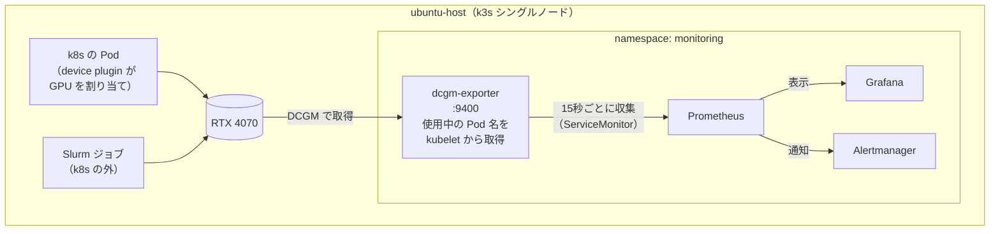

## この記事で扱うこと

[前回の記事](https://qiita.com/k1nos/items/08a5ee6aa1a57de5c9c5)では、k3s に NVIDIA device plugin を入れて、GPU を Pod に割り当てられるようにしました。割り当てられたら、次は「**どう使われているか**」と「**どれだけ電力を食っているか**」を見たくなります。

そこで、GPU サーバーの監視でよく使われる構成（DCGM Exporter → Prometheus → Grafana）を、自宅の RTX 4070 1枚の k3s に組みました。データセンター向けの GPU を前提にした仕組みを GeForce で動かすと、何が見えて、何が見えないのかを実機で確かめています。

この記事で示すのは次の4点です。

1. GeForce（RTX 4070）でも、温度・電力・使用率・クロックなどの**基本的なメトリクスは取れる**。一方で、Tensor コアやメモリ帯域の稼働率などの**プロファイリング系は取れない**
2. k8s の Pod が GPU を使うと、**どの Pod が使っているか**がメトリクスに付く。同じ GPU を **Slurm から使うと何も付かず、k8s からは「空き」に見える**
3. **電力上限を 200W → 130W に下げると、性能は 13% 落ちるだけで、性能/W は 32% 上がる**
4. 公式ダッシュボードや初期設定のままだと、**誤解しやすい表示や、アラートを作りにくい仕様**がいくつかある

---

## 構成



dcgm-exporter は、NVIDIA の監視ライブラリ DCGM（Data Center GPU Manager）でメトリクスを取り、Prometheus 形式で公開します。どの Pod がどの GPU を使っているかは、kubelet の pod-resources API で調べてラベルとして付けます。

---

## 環境

| 項目 | 内容 |
|---|---|
| OS | Ubuntu 24.04 LTS（カーネル 7.0.0-42-generic、HWE） |
| GPU | GeForce RTX 4070（VRAM 12GB、TGP 200W）/ ドライバ 595.99.02 |
| k8s | k3s v1.36.4+k3s1（containerd 2.3.4）、シングルノード |
| Helm | v3.22.0 |
| kube-prometheus-stack | チャート 92.17.1（Prometheus Operator v0.94.2） |
| dcgm-exporter | チャート 4.8.4 |
| Grafana | v13.3（kube-prometheus-stack 同梱） |
| 併存 | Slurm 23.11.4（同じ GPU を GRES で定義） |

---

## 1. kube-prometheus-stack を入れる

```yaml:values-kps.yaml
prometheus:
  prometheusSpec:
    # 別の Helm リリース（dcgm-exporter）の ServiceMonitor も拾わせる
    serviceMonitorSelectorNilUsesHelmValues: false
    podMonitorSelectorNilUsesHelmValues: false
    ruleSelectorNilUsesHelmValues: false
    retention: 7d
    scrapeInterval: 15s
# k3s はこれらを単一バイナリに内蔵しており、個別に収集できず常時アラートになるため無効化
kubeEtcd:
  enabled: false
kubeScheduler:
  enabled: false
kubeControllerManager:
  enabled: false
kubeProxy:
  enabled: false
```

```bash
helm repo add prometheus-community https://prometheus-community.github.io/helm-charts
helm repo update
kubectl create namespace monitoring
openssl rand -base64 18 > grafana_admin.txt && chmod 600 grafana_admin.txt
helm install kps prometheus-community/kube-prometheus-stack -n monitoring \
  -f values-kps.yaml --set grafana.adminPassword="$(cat grafana_admin.txt)"
```

:::note info
`serviceMonitorSelectorNilUsesHelmValues: false` を付けないと、Prometheus は**同じ Helm リリースの ServiceMonitor しか見ない**ので、後から別リリースで入れる dcgm-exporter が収集対象になりません。ServiceMonitor の CRD はこのチャートで入るので、dcgm-exporter より**先に**入れます。
:::

---

## 2. dcgm-exporter を入れる

最終的に使った values です（理由は「ハマりどころ」で説明します）。

```yaml:values-dcgm.yaml
runtimeClassName: nvidia          # k3s 同梱の RuntimeClass。GPU を見るのに必要
serviceMonitor:
  enabled: true
  interval: 15s
  scrapeTimeout: 10s
  relabelings:                    # instance を Pod IP ではなくノード名にする
    - sourceLabels: [__meta_kubernetes_pod_node_name]
      targetLabel: instance
      action: replace
  metricRelabelings:              # （記事用）ホスト名のラベルを伏せる
    - sourceLabels: [hostname]
      targetLabel: hostname
      replacement: ubuntu-host
      action: replace
customMetrics: |
  # 初期設定の一覧に、電力上限・スロットリング時間・XID 累計を追加
  DCGM_FI_DEV_SM_CLOCK,  gauge, SM clock frequency (in MHz).
  DCGM_FI_DEV_MEM_CLOCK, gauge, Memory clock frequency (in MHz).
  DCGM_FI_DEV_MEMORY_TEMP, gauge, Memory temperature (in C).
  DCGM_FI_DEV_GPU_TEMP,    gauge, GPU temperature (in C).
  DCGM_FI_DEV_POWER_USAGE,              gauge, Power draw (in W).
  DCGM_FI_DEV_POWER_MGMT_LIMIT,         gauge, Configured power management limit (in W).
  DCGM_FI_DEV_ENFORCED_POWER_LIMIT,     gauge, Effective power limit enforced by the driver (in W).
  DCGM_FI_DEV_TOTAL_ENERGY_CONSUMPTION, counter, Total energy consumption since the driver was last reloaded (in mJ).
  DCGM_FI_DEV_PCIE_REPLAY_COUNTER, counter, Total number of PCIe retries.
  DCGM_FI_DEV_GPU_UTIL,      gauge, GPU utilization (in %).
  DCGM_FI_DEV_MEM_COPY_UTIL, gauge, Memory utilization (in %).
  DCGM_FI_DEV_ENC_UTIL,      gauge, Encoder utilization (in %).
  DCGM_FI_DEV_DEC_UTIL,      gauge, Decoder utilization (in %).
  DCGM_FI_DEV_XID_ERRORS,        gauge,   Value of the last XID error encountered.
  DCGM_FI_DEV_POWER_VIOLATION,   counter, Throttling duration due to power constraints (in ns).
  DCGM_FI_DEV_THERMAL_VIOLATION, counter, Throttling duration due to thermal constraints (in ns).
  DCGM_EXP_XID_ERRORS_TOTAL,     counter, Total XID errors observed since exporter start.
  DCGM_FI_DEV_FB_FREE, gauge, Framebuffer memory free (in MiB).
  DCGM_FI_DEV_FB_USED, gauge, Framebuffer memory used (in MiB).
  DCGM_FI_DEV_UNCORRECTABLE_REMAPPED_ROWS, counter, Number of remapped rows for uncorrectable errors.
  DCGM_FI_DEV_CORRECTABLE_REMAPPED_ROWS,   counter, Number of remapped rows for correctable errors.
  DCGM_FI_DEV_ROW_REMAP_FAILURE,           gauge,   Whether remapping of rows has failed.
```

```bash
helm repo add gpu-helm-charts https://nvidia.github.io/dcgm-exporter/helm-charts
helm repo update
helm install dcgm gpu-helm-charts/dcgm-exporter -n monitoring -f values-dcgm.yaml
```

- dcgm-exporter は `nvidia.com/gpu` を要求しないので、**GPU を占有しません**（他の Pod の割り当てに影響しない）。
- 前回の device plugin は、ノードにラベルを付けるまで起動しませんでした（DESIRED 0）。dcgm-exporter のチャートは、そのままのノードで起動しました。チャートによって配置の条件が違う点に注意します。

Prometheus の Targets で `dcgm-dcgm-exporter` が `up` になれば収集できています。

```
dcgm-dcgm-exporter up http://10.42.0.72:9400/metrics
```

---

## 3. GeForce で取れるメトリクス・取れないメトリクス

dcgm-exporter の初期設定のまま、実際に出てきたメトリクスとログです。

| 分類 | メトリクス | RTX 4070 |
|---|---|---|
| 使用率 | `GPU_UTIL` / `MEM_COPY_UTIL` / `ENC_UTIL` / `DEC_UTIL` | ✅ |
| メモリ | `FB_USED` / `FB_FREE` | ✅ |
| 温度 | `GPU_TEMP` / `MEMORY_TEMP` | ✅ |
| 電力 | `POWER_USAGE` / `TOTAL_ENERGY_CONSUMPTION` | ✅ |
| 電力上限・抑制（追加） | `POWER_MGMT_LIMIT` / `ENFORCED_POWER_LIMIT` / `POWER_VIOLATION` / `THERMAL_VIOLATION` | ✅ |
| クロック | `SM_CLOCK` / `MEM_CLOCK` | ✅ |
| 健全性 | `PCIE_REPLAY_COUNTER` / `*_REMAPPED_ROWS` / `ROW_REMAP_FAILURE` | ✅ |
| XID エラー | `XID_ERRORS` | ⚠️ 値が出ない（後述） |
| **プロファイリング** | `PROF_GR_ENGINE_ACTIVE` / `PROF_PIPE_TENSOR_ACTIVE` / `PROF_DRAM_ACTIVE` / `PROF_PCIE_TX/RX_BYTES` | ❌ |
| NVLink / NVSwitch | — | ❌（GeForce に無い） |

ログにははっきり出ています。

```
level=INFO msg="Not collecting DCP metrics: Profiling is not supported for this group of GPUs or GPU"
level=WARN msg="Skipping line 19 ('DCGM_FI_PROF_GR_ENGINE_ACTIVE'): metric not enabled"
level=WARN msg="Skipping line 20 ('DCGM_FI_PROF_PIPE_TENSOR_ACTIVE'): metric not enabled"
level=WARN msg="Skipping line 21 ('DCGM_FI_PROF_DRAM_ACTIVE'): metric not enabled"
level=WARN msg="Failed to initialize NvSwitch/NvLink info" error="no switches to monitor"
```

DCGM の公式ドキュメントでは、プロファイリング系（DCP メトリクス）は **Volta 以降のデータセンター向け GPU** が対象とされており、実機でもその通りでした。

これは監視設計の上で大事な差です。`GPU_UTIL` は「**何かのカーネルが動いていた時間の割合**」でしかなく、100% でも Tensor コアがほとんど遊んでいることがあります。「GPU をどれだけ有効に使えているか」まで見たいなら、`PIPE_TENSOR_ACTIVE` や `DRAM_ACTIVE` が取れるデータセンター向け GPU が必要になります。

---

## 4. Grafana でダッシュボードを見る

公式ダッシュボード（ID `12239`、NVIDIA DCGM Exporter Dashboard）をインポートします。

```bash
kubectl -n monitoring port-forward svc/kps-grafana 3000:80
```

Dashboards → New → Import → `12239` → データソースに Prometheus を選択。


*インポート直後。instance が dcgm-exporter の Pod の IP で、Pod を作り直した 16:26 以降のデータが出ない。Power Total は実際の 38W ではなく 620W（ハマりどころ 1・2）*

このダッシュボードは **2021年9月の更新が最後**で、そのままだと誤解しやすい表示があります（ハマりどころ 1・2）。

---

## 5. 負荷をかけて観察する

同じベンチマーク（FP16 の 8192×8192 行列積を 180 秒回して平均 TFLOPS を出す）を、条件を変えて流しました。

```python:bench.py
import os, time, torch
D = int(os.environ.get("DURATION", "180")); N = 8192
x = torch.randn(N, N, device="cuda", dtype=torch.float16)
y = x @ x; torch.cuda.synchronize()
start = last = time.time(); it = 0
print(f"START {time.strftime('%H:%M:%S')} {torch.cuda.get_device_name(0)}", flush=True)
while time.time() - start < D:
    for _ in range(20): y = x @ x
    torch.cuda.synchronize(); it += 20
    now = time.time()
    if now - last >= 30:
        print(f"{now-start:5.0f}s {it*2*N**3/(now-start)/1e12:6.1f} TFLOPS", flush=True); last = now
el = time.time() - start
print(f"END {time.strftime('%H:%M:%S')} iters={it} sec={el:.1f} avg_TFLOPS={it*2*N**3/el/1e12:.1f}", flush=True)
```

電力や温度は、実行時間帯を指定して Prometheus から集計しました（`avg_over_time(DCGM_FI_DEV_POWER_USAGE[180s])` など）。

### A. アイドル

| 状態 | 平均電力 | 使用率 | SM クロック | 最高温度 |
|---|---|---|---|---|
| 再起動直後、誰も使っていない | **6.4 W** | 0% | 210 MHz | 40℃ |
| デスクトップ使用中（ブラウザで Grafana を表示など） | **26.0 W** | 26% | 578 MHz | 51℃ |

**監視画面を見ているだけで 20W 近く使います**。デスクトップ兼用の GPU では、計測中にブラウザを閉じないと結果がぶれました（ブラウザを開いたまま測ったときは 58.7 TFLOPS、閉じたら 62.3 TFLOPS）。


*21:53 ごろまでは 6〜7W。ログインしてブラウザで Grafana を開くと 20〜40W に上がる*

### B. k8s の Job で負荷をかける

```yaml:job-bench.yaml
apiVersion: batch/v1
kind: Job
metadata:
  name: bench
  namespace: gpu-bench
spec:
  backoffLimit: 0
  template:
    spec:
      runtimeClassName: nvidia
      restartPolicy: Never
      containers:
        - name: bench
          image: pytorch/pytorch:latest      # PyTorch 2.2.1
          imagePullPolicy: Never             # ローカルに取り込んだイメージを使う
          command: ["python", "/bench/bench.py"]
          env:
            - name: DURATION
              value: "180"
          resources:
            limits:
              nvidia.com/gpu: 1
          volumeMounts:
            - name: bench
              mountPath: /bench
      volumes:
        - name: bench
          configMap:
            name: bench
```

実行中のメトリクスには、**GPU を使っている Pod の名前が付きます**。

```
DCGM_FI_DEV_GPU_UTIL{gpu="0", instance="ubuntu-host", exported_namespace="gpu-bench", exported_pod="bench-86gdv", exported_container="bench", ...} 100
```

（ラベル名が `exported_*` になっている理由はハマりどころ 6）

### C. 同じ GPU を Slurm から使う

```bash
sbatch -J bench --gres=gpu:1 --wrap "DURATION=180 /path/to/venv/bin/python bench.py"
```

実行中に k8s の割り当てを見ると、こうなります。

```
$ kubectl describe node | grep -E '^\s+nvidia.com/gpu'
  nvidia.com/gpu:     1      # Capacity
  nvidia.com/gpu:     1      # Allocatable
  nvidia.com/gpu     0           0      # 割り当て済み（Requests / Limits）
```

GPU は使用率 100% で動いているのに、**k8s からは「0 個使用中＝空き」**に見えます。この状態で GPU を要求する Pod を投げると、k8s は同じ GPU に重ねて載せます。メトリクスにも Pod 名は付かず、「**誰が使っているか**」は監視から分かりません。

| | B. k8s Job | C. Slurm ジョブ |
|---|---|---|
| 性能 | 62.3 TFLOPS | 58.4 TFLOPS |
| 平均電力 | 181.5 W | 196.1 W |
| 性能/W | 343 GFLOPS/W | 298 GFLOPS/W |
| メトリクスに付く利用者 | `gpu-bench/bench-86gdv` | **なし** |
| k8s から見た GPU の割り当て | 1/1 | **0/1（空き）** |

:::note warn
B と C の性能差（約 15%）は、スケジューラーの差ではなく**ソフトウェアの差**と考えています。B はコンテナ内の PyTorch 2.2.1、C は別の Python 環境の PyTorch 2.14 で、行列積を計算する cuBLAS も版が違います。C の方が電力もクロックも高いのに遅いので、新しい版が選んだ計算方法がこの行列サイズと Ada 世代の組み合わせでは効率が悪かった可能性があります（各 1 回の計測なので断定はしません）。「**同じ GPU でも、ソフトウェアの版で性能/W が 15% 変わり得る**」という注意点として書いておきます。
:::

### D. 電力上限を下げる

`nvidia-smi -pl` で電力上限を変えながら、B と同じ Job を流しました。RTX 4070 で設定できる範囲は 100〜216W（既定 200W）でした。

```bash
sudo nvidia-smi -q -d POWER | grep -E 'Min Power Limit|Max Power Limit|Default Power Limit'
sudo nvidia-smi -pl 160     # 再起動、または -pl 200 で元に戻る
```


*赤：Slurm ジョブ（C）とアイドル、黄：200W、青：160W、橙：130W、緑：100W。k8s の Job は実行ごとに Pod 名が違うため別の色の系列になるが、Slurm のジョブはアイドルと同じ系列（赤）に混ざり、誰が使ったか区別できない*


| 電力上限 | 性能 | 平均電力 | **性能/W** | 200W 比 | 電力上限による抑制時間 |
|---|---|---|---|---|---|
| 200W | 62.3 TFLOPS | 183.0 W | 340 GFLOPS/W | — | 0 秒 |
| 160W | 59.0 TFLOPS | 147.2 W | 401 GFLOPS/W | 性能 −5%、電力 −20% | 0 秒 |
| **130W** | **54.5 TFLOPS** | **120.9 W** | **451 GFLOPS/W** | **性能 −13%、電力 −34%** | 170 秒 |
| 100W | 38.7 TFLOPS | 100.0 W | 387 GFLOPS/W | 性能 −38%、電力 −45% | 173 秒 |

- **160W はほぼ「ただ」で電力を減らせる**設定でした。性能は 5% しか落ちず、上限で抑えられた時間も 0 秒です。
- **130W で性能/W が最大**（200W 比 +32%）。
- **100W は下げすぎ**で、180 秒中 173 秒が抑制状態になり、クロックが 1690 MHz まで落ちて性能/W も悪化しました。

`DCGM_FI_DEV_POWER_VIOLATION`（電力上限で抑制された時間の累計、ナノ秒）は初期設定では無効ですが、**上限を詰めすぎていないか**を判断するのに使えます。

電力の枠が決まったラックや、電力単価が高い環境では、「上限を少し下げて同じ電力でより多くの GPU を動かす」という選択肢があることが、自宅の 1 枚でも数字で確認できました。ただし、データセンター向け GPU と GeForce では電力とクロックの特性が違い、負荷の種類（学習・推論・メモリ帯域が律速の処理）でも最適点は変わります。

---

## 6. アラートを作る

```yaml:gpu-alerts.yaml
apiVersion: monitoring.coreos.com/v1
kind: PrometheusRule
metadata:
  name: gpu-alerts
  namespace: monitoring
spec:
  groups:
    - name: gpu
      rules:
        - alert: GpuTemperatureHigh
          expr: max by (instance, gpu) (DCGM_FI_DEV_GPU_TEMP) > 83
          for: 5m
          labels: { severity: warning }
        - alert: GpuXidErrorObserved
          # 累計は XID が起きた時点で初めて系列ができるため increase() ではなく > 0 で見る
          expr: max by (instance, gpu, xid) (DCGM_EXP_XID_ERRORS_TOTAL) > 0
          labels: { severity: critical }
        - alert: GpuPowerThrottled
          # 直近 5 分のうち半分以上の時間、電力上限で抑制されている
          expr: max by (instance, gpu) (rate(DCGM_FI_DEV_POWER_VIOLATION[5m])) / 1e9 > 0.5
          for: 5m
          labels: { severity: info }
```

kube-prometheus-stack を `ruleSelectorNilUsesHelmValues: false` で入れているので、ラベルを付けなくても Prometheus に読み込まれます。

発火を確かめるため、しきい値をわざと下げたテスト用のルール（`DCGM_FI_DEV_GPU_TEMP > 30` が 1 分続いたら発火）を一時的に足しました。

```
  gpu-test GpuTemperatureTest     state=pending health=ok
  gpu      GpuTemperatureHigh     state=inactive health=ok
  gpu      GpuXidErrorObserved    state=inactive health=ok
  gpu      GpuPowerThrottled      state=inactive health=ok
```

待ち時間を 4 分に延ばして再確認すると、`firing` になり、Alertmanager まで届いていました（`Watchdog` は kube-prometheus-stack が「アラートの経路が生きている」ことを示すために常に発火させているアラートです）。

```
GpuTemperatureTest firing
['GpuTemperatureTest', 'Watchdog']     # Alertmanager が受け取っているアラート
```

確認後、テスト用のルールは削除しました。通知先（メール・Slack など）は今回は設定していません。

:::note info
`kubectl apply` から 150 秒たっても、テスト用のアラートは `pending`（条件は満たしたが `for:` の時間待ち）のままで、Alertmanager にはまだ届いていませんでした。PrometheusRule は、Operator が設定に変換 → Prometheus が再読み込み → 評価間隔（既定 30 秒）ごとに判定、という順で効くので、**`for: 1m` でも発火まで数分かかります**。発火の確認は、余裕を持って待つ必要があります。
:::

---

## 7. 値の突き合わせと、監視の仕組み自体の負荷

同じ瞬間の `nvidia-smi` と DCGM の値は一致しました。

| 項目 | nvidia-smi | DCGM |
|---|---|---|
| 電力 | 12.03 W | 12.035 W |
| 温度 | 53 ℃ | 53 ℃ |
| 使用率 | 0 % | 0 |
| メモリ使用量 | 924 MiB | 923 MiB |
| SM クロック | 210 MHz | 210 MHz |

監視の仕組み自体の負荷（`kubectl top pods -n monitoring`、アイドル時）は次のとおりです。

| Pod | CPU | メモリ |
|---|---|---|
| Grafana | 10m | 682 Mi |
| Prometheus | 10m | 524 Mi |
| dcgm-exporter | 7m | 478 Mi |
| Prometheus Operator | 2m | 79 Mi |
| kube-state-metrics | 1m | 71 Mi |
| Alertmanager | 1m | 67 Mi |
| node-exporter | 2m | 25 Mi |
| **合計** | **33m** | **約 1.9 GiB** |

CPU はほぼ使いませんが、メモリは合計で約 2 GiB です。dcgm-exporter だけで 478 Mi あるのは、DCGM 本体（ホストエンジン）を中に抱えているためです。GPU ノードが多い環境では、ノードごとにこの分が乗ります。

---

## ハマりどころ

### 1. `instance` が Pod の IP になり、再起動で絞り込みが外れる

初期設定では `instance` ラベルが `10.42.0.72:9400`（dcgm-exporter の Pod IP）になります。設定を変えて Pod を作り直したら IP が変わり、ダッシュボードの絞り込みが古い IP のまま残って**グラフが途中で途切れました**。ServiceMonitor の `relabelings` で `instance` をノード名に置き換えると、Pod が入れ替わっても同じ系列として扱えます。

### 2. 公式ダッシュボードの「GPU Power Total」が 620W と出る

消費電力 38W 前後なのに、ゲージが 620W。パネルのクエリは `sum(DCGM_FI_DEV_POWER_USAGE{...})`（複数 GPU の合計）ですが、表示の計算方法（Value options → Calculation）が **Total** になっており、**表示期間中のサンプルを全部足した値**になっていました（38W × 16 サンプル ≒ 620W。時間が経つほど増えることで確認）。**Last** に変えると正しく 35W 前後になります。


*クエリは sum()（GPU の合計）だが、Calculation が Total のため期間内のサンプルが足し合わされる*

### 3. XID エラーの値が出てこない

`DCGM_FI_DEV_XID_ERRORS` は初期設定の収集対象ですが、エラーが一度も起きていない GPU では値が出ません。累計の `DCGM_EXP_XID_ERRORS_TOTAL` は初期設定では無効で、有効にしても **XID が起きた時点で xid 番号ごとに初めて系列ができる**実装でした。

そのため、`increase(DCGM_EXP_XID_ERRORS_TOTAL[5m]) > 0` のようなアラートは、**最初の 1 件を見逃す**可能性があります（系列が途中から現れると、それ以前の値がないため増加と判定できない）。`> 0` で判定するのが安全です。

### 4. メトリクスの一覧を変えても反映されない

`customMetrics` は ConfigMap として Pod に `subPath` でマウントされるため、`helm upgrade` だけでは**読み込まれません**。`kubectl -n monitoring rollout restart ds/dcgm-dcgm-exporter` が必要です。

### 5. ホスト名がラベルに出る

dcgm-exporter は全メトリクスに `hostname` ラベルを付けます。スクリーンショットを公開する前提なら、`metricRelabelings` で収集時に置き換えておくと、毎回マスキングせずに済みます（不要なら引数 `-n` で `hostname` ラベル自体を外せます）。

### 6. 「GPU を使っている Pod」が `pod` ではなく `exported_pod` に入る

Prometheus は、収集したメトリクスに**収集先**（dcgm-exporter 自身）の `namespace` / `pod` / `container` を付けます。dcgm-exporter が付けた「GPU を使っている Pod」の同名ラベルは衝突し、ServiceMonitor の既定（`honorLabels: false`）では `exported_namespace` / `exported_pod` / `exported_container` に改名されます。`pod` を見ると**常に dcgm-exporter の名前**なので、最初は「アイドル中なのに dcgm-exporter が GPU を使っている」と読み違えました。

Grafana で同じ GPU が 2 本の線に分かれるのも、`exported_*` があるか（Pod が使用中）ないか（未使用）で別の系列になるためです。


*緑：Job の実行中（exported_pod あり）、黄：それ以外（exported_pod なし）。同じ GPU が2本に分かれる*

### 7. `latest` タグのイメージを取りに行こうとする

`image: ...:latest` は、k8s の既定で `imagePullPolicy: Always` 扱いになり、毎回レジストリに取りに行きます。`docker save | k3s ctr -n k8s.io images import -` で取り込んだローカルイメージを使うなら、`imagePullPolicy: Never`（または `IfNotPresent`）を明示します。

### 8. 同じノードの Slurm が、いつの間にか使えなくなっていた

シナリオ C の準備で、Slurm のノードが `DOWN+DRAIN+INVALID_REG` になっていました。理由は `Low socket*core*thread count, Low CPUs` で、記録上は 1 か月以上前から。

```
$ sudo slurmd -C
slurmd: error: Thread count (11) not multiple of core count (6)
NodeName=... CPUs=11 Boards=1 SocketsPerBoard=1 CoresPerSocket=6 ThreadsPerCore=1 ...
```

OS（`nproc`、`lscpu`、`/sys/devices/system/cpu`、cgroup）も hwloc（`lstopo`、`hwloc-calc`）も 12 スレッドを正しく認識しているのに、**slurmd（23.11.4）だけが 11 と数えていました**。Ubuntu 24.04 で HWE の 7.0 系カーネルに上がった時期と重なりますが、原因の特定まではできていません。今回は Slurm の `SlurmdParameters=config_overrides`（検出値ではなく設定ファイルの値を使う）で回避しました。

k8s 側は問題なく動いていたので、**k8s だけを見ていると、同じノードの Slurm が止まっていることに気づけない**、という教訓でもあります。

---

## まとめと本番環境との差

| 観点 | 今回（単一ノード・GeForce） | データセンター向け GPU・本番環境では |
|---|---|---|
| メトリクス | 基本テレメトリのみ。プロファイリング系なし | `PROF_*`（Tensor・DRAM 稼働率）、ECC、NVLink も取れる |
| 導入 | Helm で dcgm-exporter を個別に導入 | GPU Operator が device plugin・DCGM・exporter をまとめて管理するのが一般的 |
| 誰が使っているか | k8s の Pod は分かる。Slurm は分からない | 複数のスケジューラーが同じ GPU を触らない設計にする（ノードを分ける等） |
| 電力 | 上限 130W で性能/W +32% | GPU・負荷ごとに最適点が違う。ラック単位の電力枠と合わせて設計する |
| 未検証 | 複数ノード、MIG、GPU Operator、マルチテナントの権限分離 | — |

「GPU を割り当てる」だけでなく、「**どれだけ・誰が・どのくらい効率よく使っているか**」まで見ようとすると、GPU の種類・スケジューラー・ダッシュボードの設定のそれぞれに落とし穴がありました。特に、**取れないメトリクスがあることを知った上で監視を設計する**ことと、**電力を性能と同じ軸で見る**ことは、GPU サーバーの運用で効いてくる視点だと感じています。

## 参考

- [DCGM User Guide: Getting Started（対応プラットフォーム）](https://docs.nvidia.com/datacenter/dcgm/latest/user-guide/getting-started.html)
- [DCGM: Profiling](https://docs.nvidia.com/datacenter/dcgm/latest/learn/modules/profiling.html)
- [DCGM Exporter Metrics](https://docs.nvidia.com/datacenter/dcgm/latest/reference/dcgm-exporter-metrics.html)
- [NVIDIA/dcgm-exporter（GitHub）](https://github.com/NVIDIA/dcgm-exporter)
- [Grafana Dashboard 12239: NVIDIA DCGM Exporter Dashboard](https://grafana.com/grafana/dashboards/12239)
- [kube-prometheus-stack（GitHub）](https://github.com/prometheus-community/helm-charts/tree/main/charts/kube-prometheus-stack)
- [k3s: Advanced Options（NVIDIA Container Runtime Support）](https://docs.k3s.io/advanced)
- [Slurm: slurm.conf（SlurmdParameters）](https://slurm.schedmd.com/slurm.conf.html)
