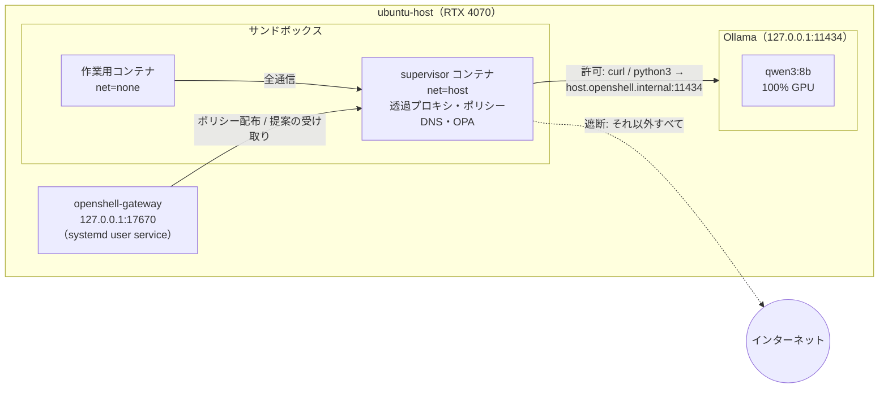
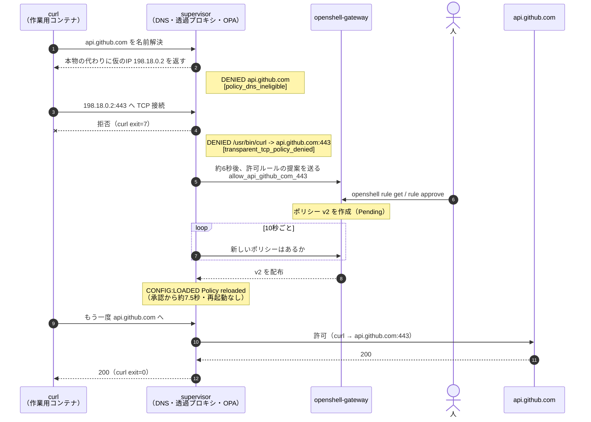

## この記事で扱うこと

AIエージェントに社内データや顧客データを触らせたい。でも、エージェントが勝手に外部へ通信するのは困る。そういう要件に対して、**「推論はローカルGPU、エージェントはサンドボックスの中、通信はポリシーで制御」**という構成を、自宅のRTX 4070 1枚で組んで検証しました。

使うのは NVIDIA の **OpenShell**（Apache-2.0 の OSS）です。2026年9月28日に発表された「Open Agent Safety Platform」の中核コンポーネントで、エージェントをサンドボックスに閉じ込め、ファイル・プロセス・ネットワークをポリシーで縛ります。

この記事で示すのは次の4点です。

1. 初期状態のサンドボックスは**外向き通信がすべて遮断**される
2. provider を付けると、**母艦のローカルLLM（Ollama）だけ**に届く
3. 宛先が同じでも、**許可していないプログラム（bash）からの接続は遮断**される
4. 遮断された通信は「許可ルールの提案」になり、**人が承認するとサンドボックスを止めずに反映**される

これまでの記事（Docker → Slurm → k3s）と同じ母艦の延長線上で、「GPU基盤の上でエージェントをどう統制するか」の小さな実例です。

:::note warn
OpenShell は更新が速く、2026年3〜9月のブログ記事にある手順（`inference.local`、privacy router、`openshell inference` コマンドなど）は v0.1.3 では削除済みです。この記事は **OpenShell v0.1.3** で確認した内容です。
:::

---

## 構成



ポイントは、エージェントが動く**作業用コンテナにはネットワークが無い**（`net=none`）ことです。通信はすべて横に付く supervisor コンテナが中継し、そこで「どのプログラムが・どこへ」を見て許可/遮断を決めます。

---

## 環境

| 項目 | 内容 |
|---|---|
| OS | Ubuntu 24.04 LTS（カーネル 7.0.0-38-generic） |
| GPU | GeForce RTX 4070（VRAM 12GB）/ ドライバ 595.99.02 |
| コンテナ | Docker 29.9.0 + NVIDIA Container Toolkit |
| 同居 | k3s（前回記事の環境。OpenShell は Docker ドライバを使用） |
| OpenShell | v0.1.3 |
| Ollama | 0.40.4（Docker） |
| モデル | qwen3:8b（5.2GB） |

OpenShell v0.1.3 の主な要件（公式 Support Matrix より）：

- Linux x86_64、カーネル 6.2 以上（Landlock ABI 3 など）
- Docker Engine **28.0 以上**（snap 版 Docker は非対応）
- 本体の動作に GPU は不要。GPU が要るのは `--gpu` を付けたサンドボックスだけ

---

## 1. ローカルLLMを起動する（Ollama）

```bash
docker run -d --gpus all --restart unless-stopped \
  -v ollama:/root/.ollama -p 127.0.0.1:11434:11434 --name ollama ollama/ollama
docker exec ollama ollama pull qwen3:8b
```

:::note info
`-p 11434:11434` と書くと Docker は **UFW のルールを素通りして LAN 全体に公開**します。母艦の中からだけ使うので `127.0.0.1:` を付けています。後述のとおり、この設定のままサンドボックスから届きます。
:::

OpenAI 互換 API で応答を確認します。

```bash
curl -s http://127.0.0.1:11434/v1/chat/completions -H "Content-Type: application/json" \
  -d '{"model":"qwen3:8b","messages":[{"role":"user","content":"こんにちは。一文で自己紹介して /no_think"}]}' \
  | python3 -c "import sys,json;print(json.load(sys.stdin)['choices'][0]['message']['content'])"
```

```
こんにちは！私はQwenと申します、AIアシスタントとして、質問にお答えしたり、文章の作成やタスクのサポートなど、さまざまなことにご協力できることをとても嬉しく思っています！
```

### 実測

```bash
docker exec ollama ollama run qwen3:8b --verbose "GPUとは何か3文で説明して /no_think" 2>&1 | tail -8
docker exec ollama ollama ps
nvidia-smi --query-gpu=memory.used,memory.total --format=csv
```

| 指標 | 値 |
|---|---|
| 生成速度（eval rate） | **83.7〜85.0 tokens/s**（2回測定） |
| 処理場所 | 100% GPU（CPU へのオフロードなし） |
| VRAM | 6,957 / 12,282 MiB（起動前 1,543 MiB → モデル分 約5.4GB） |
| コンテキスト長 | 4096（Ollama 既定） |

8B級の4bit量子化モデルなら、12GBに余裕を持って収まり、対話用途には十分な速度です。

---

## 2. OpenShell をインストールする

### 事前確認

```bash
docker version --format '{{.Server.Version}}'      # 28.0 以上か → 29.9.0
snap list 2>/dev/null | grep -i docker             # 出なければOK
uname -r                                           # 6.2 以上か → 7.0.0-38-generic
systemctl --user status podman.socket 2>/dev/null  # Podman があると Docker より優先される
ss -ltnp | grep -E ':17670|:11434'                 # ポート競合
loginctl show-user $USER | grep Linger             # no ならログアウトで gateway が止まる
```

`Linger=no` だったので有効にしておきます。

```bash
sudo loginctl enable-linger $USER
```

### テレメトリを先に切る

OpenShell は**匿名テレメトリが既定で有効**です。インストーラは入れ終わるとすぐ gateway を起動するので、**インストール前に** systemd の drop-in を置いて、初回起動から無効にします。

```bash
mkdir -p ~/.config/systemd/user/openshell-gateway.service.d
cat > ~/.config/systemd/user/openshell-gateway.service.d/no-telemetry.conf <<'EOF'
[Service]
Environment=OPENSHELL_TELEMETRY_ENABLED=false
EOF
```

### バージョンを固定してインストール

インストーラは既定で最新リリースを入れます。プレリリース（v0.1.4-pre）も出ているので、`OPENSHELL_VERSION` でタグを指定します。`curl | sh` ではなく、一度保存して中身を読んでから実行しました（.deb を取得 → checksum 検証 → `sudo apt install` → systemd user service の有効化、という流れでした）。

```bash
curl -LsSf https://raw.githubusercontent.com/NVIDIA/OpenShell/main/install.sh -o install.sh
OPENSHELL_VERSION=v0.1.3 sh install.sh
```

```
openshell: downloading v0.1.3 release checksums...
openshell: selected openshell_0.1.3-1_amd64.deb
openshell: verifying checksum...
openshell: installed openshell package from v0.1.3
✓ Gateway 'openshell' added and set as active
  Endpoint: https://127.0.0.1:17670
openshell: openshell status reports connected
```

確認します（`systemctl` はページャが起動するので `--no-pager` を付けるのが無難です）。

```bash
systemctl --user show openshell-gateway -p Environment --no-pager
ss -ltnp | grep 17670
```

```
Environment=OPENSHELL_LOCAL_TLS_DIR=... OPENSHELL_TELEMETRY_ENABLED=false
LISTEN 0 128 127.0.0.1:17670 0.0.0.0:* users:(("openshell-gatew",...))
```

テレメトリ無効、gateway は loopback のみで待ち受けています。

---

## 3. 検証用イメージを用意する

既定のサンドボックスイメージには **`curl` も `python3` も入っていません**。OpenShell の通信許可は「どのプログラムからの通信か」（例: `/usr/bin/curl`）で指定するので、検証には curl 入りのイメージを作ります。

```dockerfile
FROM ubuntu:24.04
RUN apt-get update && apt-get install -y --no-install-recommends curl ca-certificates python3 \
 && rm -rf /var/lib/apt/lists/*
USER ubuntu
WORKDIR /home/ubuntu
```

```bash
docker build -t openshell-demo:curl .
```

`USER ubuntu`（UID 1000）にしているのは、OpenShell が root で動くイメージを拒否するためです。ローカルでビルドしたイメージは、Docker ドライバがレジストリより先に探してくれます。

---

## 4. 初期ポリシーで遮断されることを確かめる

```bash
openshell sandbox create --name demo --from openshell-demo:curl
```

サンドボックスの中で：

```bash
curl -sS -m 10 -o /dev/null -w '%{http_code}\n' https://api.github.com; echo "exit=$?"
curl -sS -m 10 http://host.openshell.internal:11434/api/tags; echo "exit=$?"
```

```
curl: (7) Failed to connect to api.github.com port 443 after 3 ms: Couldn't connect to server
000
exit=7
curl: (6) Could not resolve host: host.openshell.internal
exit=6
```

外部は即座に拒否され、母艦の Ollama は名前すら引けません。ログを見ると、遮断の流れが追えます。

```bash
openshell logs demo -n 50 --source sandbox
```

```
NET:LISTEN [INFO] 127.0.0.1:3128
NET:REFUSE [MED] DENIED api.github.com [reason:policy_dns_ineligible]
CONFIG:OBSERVATION [INFO] Policy DNS staged unapproved name api.github.com synthetic=198.18.0.2 for TCP policy review
NET:OPEN [MED] DENIED /usr/bin/curl(0) -> api.github.com:443 [reason:transparent_tcp_policy_denied]
NET:REFUSE [MED] DENIED host.openshell.internal [reason:policy_dns_ineligible]
Flushed denial analysis to gateway proposals=1 sandbox_name=demo summaries=1
```

読み取れること：

- サンドボックス内で**透過プロキシ**（`127.0.0.1:3128`）が動いている。`HTTP_PROXY` などの環境変数は設定されておらず、アプリ側の協力なしに全通信が通る
- 未許可の名前には、DNS の段階で本物の IP の代わりに**仮の IP**（`198.18.0.2`、ログ上は `synthetic`）を返し、その IP への TCP 接続を拒否する。`198.18.0.0/15` は機器の性能試験用に予約された範囲で、インターネット上には存在しないアドレス。curl が名前解決エラーではなく接続エラーになるのはこのため
- 拒否ログに**接続元のプログラム**（`/usr/bin/curl`）が記録される
- 遮断が**許可ルールの提案**としてまとめられ、gateway に送られる

効いているポリシーには `network_policies` 自体がありません。

```bash
openshell policy get demo --full
```

```yaml
version: 1
filesystem_policy:
  include_workdir: true
  read_only: [/bin, /usr, /lib, /proc, /dev/urandom, /etc, /var/log]
  read_write: [/tmp, /dev/null]
landlock:
  compatibility: best_effort
```

---

## 5. ローカルLLMだけを許可する（provider）

推論先は、ポリシーではなく **provider profile** で定義します。公式ドキュメントの Ollama 用 profile をもとに、許可するプログラムを今回のイメージに合わせて絞りました。

```yaml:ollama-profile.yaml
id: ollama-openai
display_name: Ollama
description: Host-local Ollama OpenAI-compatible API
category: inference
inference_capable: true
credentials: []
endpoints:
  - host: host.openshell.internal
    port: 11434
    protocol: rest
    access: read-write
    enforcement: enforce
binaries:
  - /usr/bin/curl
  - /usr/bin/python3
```

```bash
openshell profile lint -f ollama-profile.yaml
openshell profile import -f ollama-profile.yaml
openshell provider create --name ollama --type ollama-openai
```

```
Provider profile lint passed.
Imported 1 provider profile.
✓ Created provider ollama
```

provider を付けてサンドボックスを作ります。Ollama は認証しないので、ダミーのキーすら不要です。

```bash
openshell sandbox create --name llm --from openshell-demo:curl \
  --provider ollama --env OPENAI_BASE_URL=http://host.openshell.internal:11434/v1
```

サンドボックスの中で4つ試します。

```bash
# 1. 許可したプログラム → Ollama（モデル一覧）
curl -sS -m 10 $OPENAI_BASE_URL/models
# 2. 許可したプログラム → Ollama（推論）
curl -sS -m 60 $OPENAI_BASE_URL/chat/completions -H 'Content-Type: application/json' \
  -d '{"model":"qwen3:8b","messages":[{"role":"user","content":"Say hello in Japanese in one sentence. /no_think"}]}' \
  | python3 -c "import sys,json;print(json.load(sys.stdin)['choices'][0]['message']['content'])"
# 3. 許可したプログラム → 外部
curl -sS -m 10 -o /dev/null -w '%{http_code}\n' https://api.github.com
# 4. 許可していないプログラム（bash） → 同じ Ollama
timeout 5 bash -c 'echo > /dev/tcp/host.openshell.internal/11434' && echo OPEN || echo BLOCKED
```

```
{"object":"list","data":[{"id":"qwen3:8b","object":"model","created":...,"owned_by":"library"}]}
こんにちは。
curl: (7) Failed to connect to api.github.com port 443 after 1 ms: Couldn't connect to server
000
bash: connect: Permission denied
BLOCKED
```

ログ：

```
NET:OPEN [INFO] ALLOWED /usr/bin/curl(0) -> host.openshell.internal:11434 [policy:_provider_ollama engine:opa]
HTTP:GET [INFO] ALLOWED GET http://host.openshell.internal:11434/v1/models [policy:_provider_ollama engine:l7]
NET:OPEN [INFO] ALLOWED /usr/bin/curl(0) -> host.openshell.internal:11434 [policy:_provider_ollama engine:opa]
HTTP:POST [INFO] ALLOWED POST http://host.openshell.internal:11434/v1/chat/completions [policy:_provider_ollama engine:l7]
NET:OPEN [MED] DENIED /usr/bin/curl(0) -> api.github.com:443 [reason:transparent_tcp_policy_denied]
NET:OPEN [MED] DENIED /usr/bin/bash(0) -> host.openshell.internal:11434 [reason:transparent_tcp_policy_denied]
```


*左でテストを実行すると、右のログに許可（ALLOWED）と遮断（DENIED）が流れる。SSH:OPEN は sandbox exec 自身の接続*

provider から生成されたルールが、効いているポリシーに合成されています。

```yaml
network_policies:
  _provider_ollama:
    name: _provider_ollama
    endpoints:
      - host: host.openshell.internal
        port: 11434
        protocol: rest
        enforcement: enforce
        access: read-write
    binaries:
      - path: /usr/bin/curl
      - path: /usr/bin/python3
```

---

## 6. 遮断された通信を承認して、止めずに反映する

最後に、エージェント運用で一番効いてくる機能を試します。遮断された通信は「許可ルールの提案」になり、**人が承認するまで通りません**（`--approval-mode manual` が既定）。承認すると、サンドボックスを再起動せずに反映されます。

流れ全体を図にすると次のとおりです（番号はログで確認した順）。




対話シェルで作ったサンドボックスは、シェルを抜けると止まってしまうので、`--detach` で常駐させます。

```bash
openshell sandbox create --name hot --from openshell-demo:curl --detach -- sleep infinity
openshell sandbox exec hot -- curl -sS -m 10 -o /dev/null -w '%{http_code}\n' https://api.github.com
# → 000（遮断）
```

数秒後、提案が届いています。

```bash
openshell rule get hot --status pending
```

```
Network Rules:  (version 1, 1 chunk)

  Chunk: 05951aa7-...
  Status: pending
  Rule: allow_api_github_com_443
  Binary: /usr/bin/curl
  Confidence: 65%
  Rationale: Allow curl to connect to api.github.com:443 (HTTPS).
  Prover: prover: no new findings
  Endpoints: api.github.com:443 [L4]
  Binaries: /usr/bin/curl
```

「どのプログラムが、どこへ」まで絞り込まれた提案です。承認します。

```bash
openshell rule approve hot --chunk-id 05951aa7-...
```

```
OK Chunk approved. Policy version: 2, hash: 689f4f46ab67
```

10秒ほど待ってから再試行すると、通るようになります。

```bash
openshell policy list hot
openshell sandbox exec hot -- curl -sS -m 10 -o /dev/null -w '%{http_code}\n' https://api.github.com
```

```
VERSION  HASH           STATUS       CREATED
2        689f4f46ab67   Loaded       ...
1        a45a8ff3564f   Superseded   ...
200
```

```
CONFIG:LOADED [INFO] Policy reloaded successfully [policy_hash:689f4f46ab67...]
```

承認から反映まで約7.5秒でした。


*承認前は 000（遮断）→ 提案を確認 → 承認 → 200（許可）。サンドボックスは止めていない*


---

## 検証結果まとめ

| # | 試したこと | 期待 | 結果 |
|---|---|---|---|
| 1 | 初期ポリシーで外部（api.github.com）へ | 遮断 | ✅ 遮断（`DENIED ... transparent_tcp_policy_denied`） |
| 2 | 初期ポリシーで母艦の Ollama へ | 遮断 | ✅ 名前解決から拒否 |
| 3 | provider 付きで curl → Ollama | 応答 | ✅ モデル一覧・推論とも成功 |
| 4 | provider 付きで curl → 外部 | 遮断 | ✅ 遮断 |
| 5 | provider 付きで **bash** → Ollama | 遮断 | ✅ 遮断（宛先が同じでもプログラムで判定） |
| 6 | 遮断のログ | 記録 | ✅ プログラム・宛先・理由まで記録 |
| 7 | 提案を承認 → 再試行 | 通る | ✅ 再起動なしで約7.5秒後に反映 |

---

## ハマりどころ

### 既定イメージに curl が無い

`which curl python3` が何も返しません。ポリシーはプログラムのパスで許可を出すので、自分のイメージに入っているパスを `binaries` に書く必要があります。

### profile には `display_name` などが必須

`id` / `endpoints` / `binaries` だけでは lint で落ちます。

```
error ollama-profile.yaml profile=- field=file failed to parse provider profile YAML: missing field: display_name
```

公式ドキュメントの例どおり `display_name` / `description` / `category` / `inference_capable` も書きます。

### `host.openshell.internal maps to a non-link-local IP` という警告

サンドボックス起動時に次の WARN が出ます。

```
host.openshell.internal maps to a non-link-local IP; trusted-gateway SSRF exemption disabled ip=127.0.0.1
```

OpenShell は loopback（`127.0.0.0/8`）への接続を常に遮断する設計なので、「Ollama に届かないのでは」と身構えましたが、**結果的には問題ありませんでした**。ソースコードを読むと、この警告はサンドボックスの `/etc/hosts` から読む「信頼済みゲートウェイ」の例外（rootless Podman のリンクローカル用）が無効になった、という意味です。Docker ドライバでは、宛先をコンテナを動かす側から固定して渡す別の経路で `host.openshell.internal` が扱われ、`net=host` の supervisor から母艦の `127.0.0.1:11434` に届きます。

### シェルを抜けるとサンドボックスが止まる

`openshell sandbox create`（コマンド省略）は対話シェルがメインプロセスになるので、`exit` で抜けると終了します。このとき**最後のコマンドの終了コード**で `Completed` / `Error` が変わります（`grep` が0件で終わると `Error`）。その場で許可を足す検証には `--detach -- sleep infinity` で常駐させます。

### 提案と反映にはタイムラグがある

- 遮断から提案がまとめられるまで：約6秒
- 承認から反映まで：最大10秒（supervisor が10秒ごとに gateway へ問い合わせる。`OPENSHELL_POLICY_POLL_INTERVAL_SECS`）

承認直後に試して「まだ遮断される」と慌てないこと。

---

## 考察：どこまで「外に出ない」と言えるか

正直に範囲を書いておきます。

**言えること**
- サンドボックス内のエージェントは、許可したプログラムから許可した宛先（母艦の Ollama）にしか通信できない
- 新しい通信先は、人が承認するまで開かない。承認は記録に残る
- OpenShell のテレメトリは初回起動から無効

**言えないこと**
- **初回セットアップ時はネット接続が必要**です（インストーラ、OpenShell のコンテナイメージ、ベースイメージ、モデルの取得）
- **Ollama 自体はサンドボックスの外**にいて、通常の Docker ネットワークを持っています。今回統制したのは「エージェント → LLM」の境界であって、LLM サーバー自身の通信ではありません。厳密にやるなら Ollama 側も外部に出られないネットワークに置く必要があります
- サンドボックス内で承認した通信先（今回の api.github.com）は、当然外に出られます

もう一つ、**外に出られないことは、エージェントが検索で事実を確かめられないこと**でもあります。次の「おまけ」のとおり、手元のモデルの知識だけに頼ると、知らないことを自信満々に作り話で答えます。「外に出ない」構成を実用にするには、社内文書など正しい情報を手元から渡す仕組み（RAG）がセットで必要です。

それでも、「プライベートLLMを顧客拠点に置く」ような案件の縮小版として、**エージェントの統制をアプリではなくインフラ側でかけられる**ことは確認できました。エージェントのコードを信用しなくても、ポリシーとログで境界を説明できるのが大きいと感じます。

---

## おまけ：ローカルLLMに OpenShell について聞いてみた

せっかくなので、構築した qwen3:8b に直接聞いてみました。

```bash
docker exec -it ollama ollama run qwen3:8b
```

### そのまま聞く（思考モードあり）

```
>>> /set think
>>> OpenShell とは何ですか?
Thinking...
... First, there's the OpenShell project in the Linux community. I remember it's related to
creating a shell environment for Windows ... Oh right, the OpenShell project was a fork of
Windows Subsystem for Linux (WSL) ... Wait, I should verify that. ...
...done thinking.

OpenShell は、主に以下のような2つの文脈で使われる用語です。
### 1. Linux / Windows の Shell プロジェクト（OpenShell）
  ... Windows Subsystem for Linux (WSL) をベースにしたフォーク（分岐）として始まりました。
  ... その後は Microsoft が OpenShell を購入して、WSL の一部として統合する方向に進みました。
### 2. Windows の UI コンポーネント（OpenShell）
  Windows 10 / 11 で使用される、タスクバーやスタートメニューの一部として機能する UI コンポーネントです。
```

どちらも事実ではありません。1は存在しない話で、2は関係が逆です（実在する「Open-Shell」は Classic Shell を引き継いだ有志のスタートメニュー置き換えソフトで、Windows の一部ではありません）。NVIDIA OpenShell はモデルの学習時期より新しいので、知らなくて当然です。

面白いのは、**思考の中では `Wait, I should verify that` と迷っているのに、答えでは断定している**ことです。確かめる手段が無いので、迷いが答えに反映されません。表まで付いた整った体裁が、かえって誤りを信じさせやすくしています。

### そのまま聞く（思考モードなし）

```
>>> /set nothink
>>> OpenShell とは何ですか?
OpenShell は、Windows オペレーティングシステムにおいて、デスクトップやスタートメニューの
UI（ユーザーインターフェース）をカスタマイズするためのオープンソースのツールです。
...
3. PowerToys と連携
...
OpenShell の公式リポジトリは以下です：
https://github.com/OpenShell/OpenShell
```

こちらは「有志のオープンソースのスタートメニュー置き換えツール」という大筋が合っていて、思考モードありより正確でした。ただし PowerToys との連携や、デスクトップの背景のカスタマイズは作り話で、**リポジトリの URL も実在のもの（`Open-Shell/Open-Shell-Menu`）とは違います**。各1回だけの試行なので、思考モードの有無で優劣は言えません。

それより気になるのは、**それらしい URL を作ってしまう**点です。エージェントがこの URL を取りに行く作りだったら、存在しない（あるいは誰かが後から取得した）宛先に通信することになります。OpenShell のサンドボックス内なら、この通信は許可ルールの提案として止まり、人の目を通ります。ネットワークを統制する意味が、ここでも見えます。

### 資料を渡してから聞く（思考モードなし）

```
>>> /set nothink
>>> /clear
>>> 次の資料だけを根拠に答えてください。資料にないことは「資料にない」と答えてください。
... 資料: NVIDIA OpenShell は、AIエージェントをサンドボックスの中で動かし、ファイル・プロセス・
... ネットワークへのアクセスをYAMLのポリシーで制御するオープンソースソフトウェアである。ライセンス
... はApache-2.0。遮断された通信は許可ルールの提案になり、人が承認すると反映される。
... 質問1: OpenShell のライセンスは?
... 質問2: OpenShell は GPU が必須ですか?
質問1: OpenShell のライセンスは **Apache-2.0** です。

質問2: 資料にない。
```

根拠を渡すと、8B級でも資料の範囲で正しく答え、**書いていないことは「資料にない」と答えられました**。思考モードを切っていても同じです。

「外に出ないエージェント」に必要なのは、大きなモデルよりも、**正しい情報を手元から渡す仕組み**だというのが実感です。

---

## まとめ

- OpenShell v0.1.3 + Ollama で、RTX 4070 1枚の母艦に「ローカルLLMにしか話せないエージェント実行環境」を組めた
- 遮断は「DNS → TCP → HTTP」の段階で、**どのプログラムが・どこへ**まで判定・記録される
- 遮断は提案になり、承認すると**止めずに**反映される

シリーズの流れで言うと、Docker で GPU をコンテナに渡し、Slurm と k3s で GPU をジョブとリソースとして配り、今回 OpenShell でその上で動くエージェントの行動範囲を縛った、という位置づけです。次は `--gpu` 付きサンドボックスで、推論そのものをサンドボックスの中に入れる構成も試してみたいです。

## 参考

- [NVIDIA/OpenShell（GitHub）](https://github.com/NVIDIA/OpenShell)
- [OpenShell v0.1.3 リリース](https://github.com/NVIDIA/OpenShell/releases/tag/v0.1.3)
- [Support Matrix](https://docs.nvidia.com/openshell/latest/about/support-matrix)
- [Inference（Ollama の provider profile 例）](https://docs.nvidia.com/openshell/latest/how-it-works/inference)
- [Default Policy](https://docs.nvidia.com/openshell/latest/how-it-works/policies/default-policy)
- [Telemetry](https://docs.nvidia.com/openshell/latest/observability/telemetry)
- [NVIDIA Open Agent Safety Platform（発表）](https://nvidianews.nvidia.com/news/open-agent-safety-platform)
